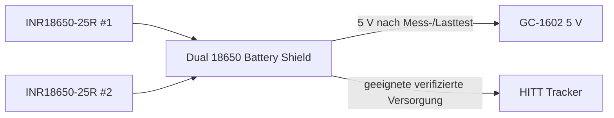

# V2 – Elektrik und Verdrahtung

## Gelieferter Tracker

Das reale Board ist mit **HITT-Tracker V1.2** beschriftet. Auf der Rückseite sind **SX1262** und **UC6580** eindeutig erkennbar. Die öffentliche Heltec-Dokumentation der V1.1-Familie nennt ESP32-S3FN8, SX1262, UC6580, Type-C, Lithium-Akkuinterface und dieselbe GNSS-/LoRa-Architektur.

Wichtige belegte Pins der V1.1-Familie:

- GPIO33 = GNSS_TX → ESP32 RX
- GPIO34 = GNSS_RX → ESP32 TX
- GPIO3 = Vext/GNSS power control
- GPIO8…14 = LoRa
- GPIO38…42 = TFT

## GC-1602-INT an ESP32

> **Stand 20.10.2026, real umgesetzt und verifiziert – weicht von der ursprünglichen Planung ab.** Zunächst war GPIO17 mit einem klassischen Spannungsteiler (10 kΩ/20 kΩ) vorgesehen. Real verdrahtet wurde **GPIO7**, und der Teiler musste komplett entfallen. Grund und Herleitung unten.

**Finale Verdrahtung:**

- GC-1602 `INT` (Header P3) → **ein** Widerstand **150 kΩ** in Reihe → ESP32 **GPIO7**
- **Kein** zweiter Widerstand nach GND (kein Spannungsteiler!)
- GC-1602 `GND` (P3) → Tracker `GND`
- `5V` an P3 bleibt unbeschaltet

Gezählt wird weiterhin auf der **fallenden Flanke**.

**Warum kein Spannungsteiler:** Der INT-Ausgang des GC-1602 treibt das Signal nur sehr schwach (vermutlich nur ein hochohmiger Pull-up auf der Platine, kein aktiver Logiktreiber). Ruhepegel gemessen: **4,39 V** (Nano-Pin D2 gegen GND, 19.09.2026). Ein klassischer Teiler mit 10 kΩ/20 kΩ (30 kΩ Gesamtlast) hat den Pegel so weit einbrechen lassen, dass selbst der eingebaute Nano keine sauberen Flanken mehr erkannte (LCD zeigte 0 CPM). Auch 150 kΩ + 150 kΩ (300 kΩ Last) reichte noch nicht. Erst ein **einzelner Widerstand ohne Pfad nach GND** (nur `INT` → 150 kΩ → GPIO7) ließ die Last auf wenige µA sinken – die interne ESD-/Klemmdiode des ESP32-S3 begrenzt dabei die Spannung an GPIO7 passiv auf ca. 3,6–3,9 V, der Reststrom liegt bei (4,4 V − 3,6 V) / 150 kΩ ≈ 5 µA. Diese Methode (Vorwiderstand + interne Klemmdiode statt Spannungsteiler) ist Standard für genau diesen Fall: ein sehr schwacher Quellenausgang, der keine zusätzliche Last verträgt.

**Warum GPIO7 statt GPIO17:** Reine Verwechslung beim Verdrahten (Platinenbeschriftung "7" statt "17" an Header J3 missverstanden). Da GPIO7 in der Firmware ursprünglich als `SD_CS` für die (ohnehin unbenutzte) microSD-Karte reserviert war, wurde `SD_CS` in der Firmware auf **GPIO15** verschoben, um den Pinkonflikt zu vermeiden (siehe [microSD](#microsd) unten). GPIO17 selbst ist dadurch frei und könnte bei Bedarf künftig anders genutzt werden.

**Ausführliche Herleitung inkl. aller Messwerte:** [08a-phase-d-int-schnittstelle.md](08a-phase-d-int-schnittstelle.md).

## microSD

| microSD SPI | Tracker |
|---|---|
| CLK | GPIO4 |
| MISO | GPIO5 |
| MOSI | GPIO6 |
| CS | GPIO15 |
| VCC | 3V3 |
| GND | GND |

GPIO4, 5, 6 und 15 sind im dokumentierten Tracker-Pinout frei von LoRa/TFT/GNSS. `CS` wurde von GPIO7 auf GPIO15 verschoben, weil GPIO7 jetzt vom GC-1602-INT belegt ist (siehe oben). Die SD-Karte ist in der Firmware zusätzlich per `#ifdef ICEGEIGER_ENABLE_SD` komplett abgeschaltet, solange keine Karte angeschlossen ist – ihr SPI-Bus (HSPI) würde sich sonst mit dem des TFT-Displays überschneiden. Leitungen kurz halten.

## GNSS

```cpp
pinMode(3, OUTPUT);
digitalWrite(3, HIGH);
Serial1.begin(115200, SERIAL_8N1, 33, 34);
```

GPIO33 ist MCU-RX vom UC6580-TX, GPIO34 MCU-TX zum UC6580-RX.

## Aktueller Akku-/5-V-Zweig – Battery Shield

Field Case v1.4 ersetzt den separaten 1S2P-Halter, BMS und Pololu-Boost mechanisch durch das vorhandene duale 18650 Battery Shield.



Das reale Shield ist mechanisch mit **100,2 × 48,0 mm** vermessen. Optisch entspricht es der DFR0969/OKY3604-2-artigen Powerbank-Shield-Familie mit HOLD/NORMAL, Ladeelektronik, Schutz und 5-V-Ausgang. Weil Clone-Revisionen variieren, werden diese elektrischen Funktionen **vor Anschluss** mit Multimeter und Last geprüft und nicht nur aus dem Aussehen abgeleitet.

### Erstinbetriebnahme des Battery Shields

1. beide 25R einzeln messen und nur bei nahezu gleicher Zellspannung gemeinsam einsetzen,
2. Polarität der beiden Schächte gegen die PCB-Markierung prüfen,
3. Shield ohne IceGeiger einschalten,
4. 5-V-Ausgang messen,
5. Testlast anschließen und Spannung/Strom/Temperatur beobachten,
6. NORMAL/HOLD testen,
7. Ruhestrom in HOLD messen,
8. erst danach GC-1602 und Tracker anschließen.

Hinweis: Bei einigen Shields dieser Bauart erzwingt HOLD den Dauerbetrieb mittels Zusatzlast. Das verhindert das Powerbank-Auto-Off, erhöht aber den Ruhestrom. Für den Schuppenbetrieb muss der reale Verbrauch deshalb gemessen werden.

## Batterie-Messung

Heltec dokumentiert für GPIO1 `VBAT = Vbat_Read × 4.9`. Ob GPIO1 in der finalen Battery-Shield-Versorgung weiterhin die reale Zellspannung sinnvoll abbildet, wird beim Verdrahtungstest gegen das Multimeter geprüft. Falls nicht, wird die Firmware-Skalierung bzw. der Messpunkt angepasst.

## HF/GNSS-Anordnung

Der Tracker sitzt auf der herausnehmbaren Service-Brücke oberhalb des Battery Shields. Unter der GNSS-Patchantenne ist der Bridge-Bereich offen. LoRa wird über ein kurzes U.FL→SMA-Pigtail zu einer abgedichteten SMA-Durchführung geführt.
